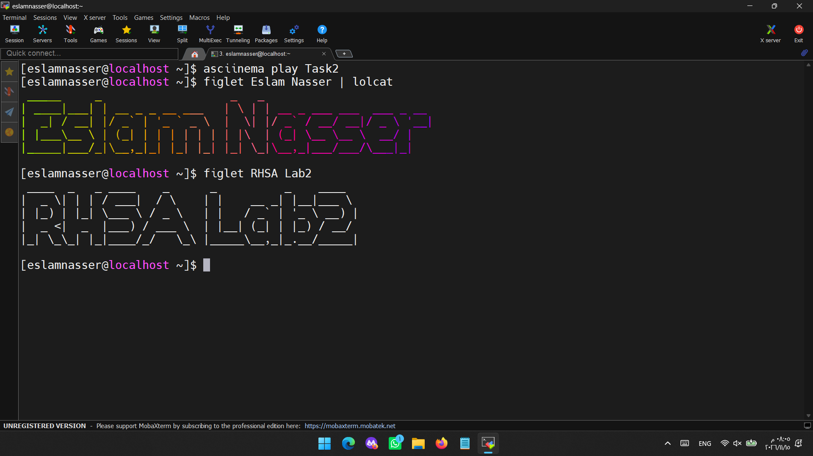

# Lab 2

lab record
[](https://asciinema.org/a/pE2JafNomhlc6QeH?autoplay=1&loop=1&speed=2)

## Create a user account-> username: eslam | Fullname: Eslam Nasser | Password eslam
``` bash
useradd -c 'Eslam Nasser' -p $(openssl passwd eslam) eslam
```

## Create a user account-> username: baduser | Fullname: Bad User | Password baduser
``` bash
useradd -c 'Bad User' -p $(openssl passwd baduser) baduser
```

## Create a supplementary (Secondary) group called pgroup with group ID of 30000
``` bash
groupadd -g 30000 pgroup
```

## Create a supplementary group called badgroup
``` bash
groupadd badgroup
```

## Add eslam user to the pgroup group as a supplementary group
``` bash
usermod -aG pgroup eslam
```

## Modify the password of eslam's account to password
``` bash
passwd eslam
 password
```

## Lock bad user account so he can't log in
``` bash
passwd -l baduser
```

## Delete bad user account
``` bash
userdel -r baduser
```

## Delete the supplementary group called badgroup
``` bash
groupdel badgroup
```

## Using the useradd command, add accounts for the following users in your system: user1, user2, user3, user4, user5, user6 and user7
``` bash
useradd -p $(openssl passwd user1) user1
useradd -p $(openssl passwd user2) user2
useradd -p $(openssl passwd user3) user3
useradd -p $(openssl passwd user4) user4
useradd -p $(openssl passwd user5) user5
useradd -p $(openssl passwd user6) user6
useradd -p $(openssl passwd user7) user7
```

## sales 10000 | hr 10001 | web 10002
``` bash
groupadd -g 10000 sales
groupadd -g 10001 hr
groupadd -g 10002 web
```

## add user1 and user2 to the sales auxiliary group
``` bash
usermod -aG sales user1
usermod -aG sales user2
```

## user3 and user4 to the hr auxiliary group.
``` bash
usermod -aG hr user3
usermod -aG hr user4
```

## User5 and user6 to web auxiliary group
``` bash
usermod -aG web user5
usermod -aG web user6
```

## add user7 to all auxiliary groups
``` bash
usermod -aG sales,hr,web user7
```

## Login as each user and use id command to verify that they are in the appropriate groups